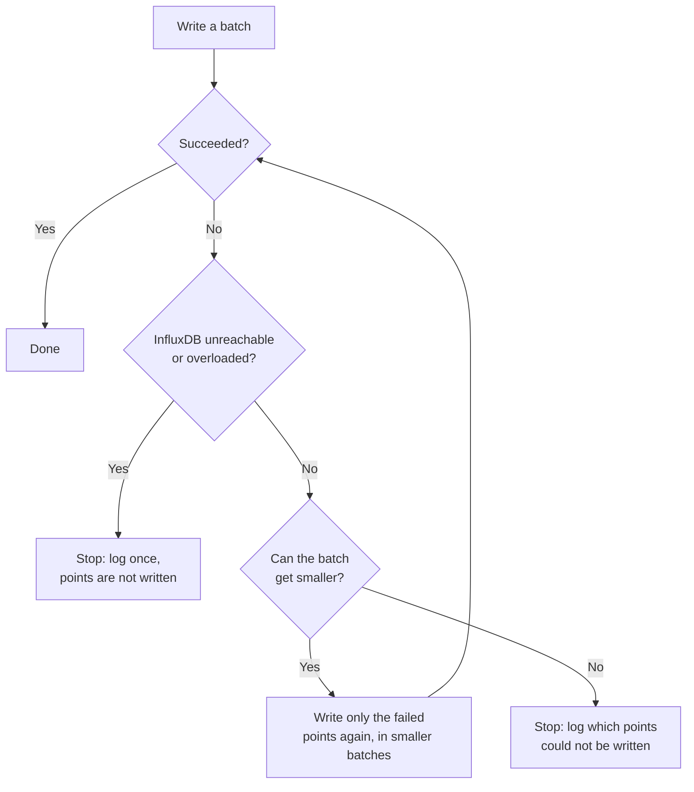

# Quieter, Faster InfluxDB Write Failures — and No Duplicate Data Points

When Butler SOS cannot write metrics to InfluxDB, it retries. That retry logic has been
reworked. The visible results:

- **When InfluxDB is down, the log stays readable.** A failed write now produces a handful of
  log lines instead of hundreds.
- **A partly failed write no longer stores some data points twice.**
- **Error counts for InfluxDB writes are accurate**, instead of several times too high.

This applies to InfluxDB v1, v2 and v3 alike.

---

## How Butler SOS writes to InfluxDB

Butler SOS sends data points to InfluxDB in batches — at most `maxBatchSize` points per request
(see the setting at the end of this page). If a request fails with a temporary problem — a
timeout, a dropped connection, or InfluxDB answering that it is overloaded or briefly unavailable
— Butler SOS retries it up to three more times, waiting 1, 2 and then 4 seconds between attempts.
When InfluxDB says how long to wait (an HTTP `Retry-After` header), Butler SOS waits at least
that long, up to 60 seconds.

If the batch still fails, Butler SOS tries again with **smaller batches**: 500, 250, 100, 10 and
finally 1 point per request. This is meant for the case where one bad data point makes InfluxDB
reject a whole batch. With small enough batches, everything except the bad point gets through.

---

## What was wrong

### Hundreds of log lines when InfluxDB was unreachable

When InfluxDB was down, or the address in the config was wrong, Butler SOS still went through
every smaller batch size. Smaller batches cannot help when the server cannot be reached at all,
so every step failed the same way, each after its own retries:

- A single data point was attempted **24 times**.
- A batch of 25 points was attempted **more than 120 times**.
- Large batches could take hours to give up, one point at a time.

Each failure was also recorded as a separate error event, and each of those was written to
InfluxDB, which was down, with the same retries. In practice one lost data point could produce
**close to 300 log lines**, burying whatever else was in the log.

### Data points stored twice

When part of a batch failed, the next, smaller attempt wrote **all** the points again,
including those that had already been stored. InfluxDB keeps these as separate points, so sums
and counts built on them — event counts, for example — came out too high.

### Error counts several times too high

A failed write was counted once for every batch size tried, plus once more. Daily error counts
and the error summary in the log reported InfluxDB write failures up to **seven times** too
often. With InfluxDB v2, failed writes of health metrics, user sessions and user events were
counted twice.

---

## What happens now



- **Unreachable or overloaded InfluxDB: stop after the normal retries.** If InfluxDB cannot be
  reached at all, or keeps answering that it is overloaded or unavailable, Butler SOS still
  retries each request (four attempts in about 7 seconds, longer if InfluxDB asks for it), but
  then gives up on that batch instead of trying smaller ones. The batches after it are not
  attempted either, as they would fail the same way.
- **Only failed points are written again.** Points that were stored successfully are not sent a
  second time, so they are not duplicated.
- **No pointless retries.** A batch size that would not make the batch any smaller is skipped,
  so a single data point is written once (with its retries), not once per batch size.
- **One error per failed write.** Each failed write is counted once, and its error event is
  written to InfluxDB with a single attempt. If InfluxDB is down, that attempt fails quickly
  and quietly instead of adding more retries to the log.
- **InfluxDB v2: no hidden extra retries.** The InfluxDB v2 client library also retried failed
  writes in the background, on top of Butler SOS's own retries. That is now turned off for all
  v2 writes, so a failed write is retried only as described above. Butler SOS's own retries now
  cover the overloaded and unavailable answers the v2 library used to retry, for all InfluxDB
  versions.

### What counts as "unreachable" or "overloaded"

Butler SOS treats these as InfluxDB being unreachable or overloaded, and stops instead of trying
smaller batches:

| Error | Meaning |
|-------|---------|
| `ECONNREFUSED` | Nothing is listening on the InfluxDB host and port — InfluxDB is stopped, or the port is wrong |
| `ENOTFOUND` | The InfluxDB host name cannot be found — usually a typo in the config, or a DNS problem |
| `EAI_AGAIN` | A temporary DNS failure |
| `EHOSTUNREACH`, `ENETUNREACH` | There is no network route to the InfluxDB host |
| `No host available` | InfluxDB v1 only: the client has marked the server as down after earlier failures |
| HTTP `429` | Too many requests — InfluxDB, or a service in front of it, is limiting how fast it accepts writes. Still failing after the retries. |
| HTTP `408`, `502`, `503`, `504` | InfluxDB, or a proxy or load balancer in front of it, is overloaded, restarting or briefly unavailable. Still failing after the retries. |

Timeouts and dropped connections (`ETIMEDOUT`, `ECONNRESET`) still go through smaller batches,
because a smaller request can succeed where a large one timed out.

---

## What you will see in the log

With InfluxDB v3 stopped, a failed write of Butler SOS memory metrics now looks like this:

```text
warn: INFLUXDB V3 RETRY: Memory usage metrics (chunk 1/1, points 0-0) - Retryable error (Error) on attempt 1/4, retrying in 1000ms...
warn: INFLUXDB V3 RETRY: Memory usage metrics (chunk 1/1, points 0-0) - Retryable error (Error) on attempt 2/4, retrying in 2000ms...
warn: INFLUXDB V3 RETRY: Memory usage metrics (chunk 1/1, points 0-0) - Retryable error (Error) on attempt 3/4, retrying in 4000ms...
error: INFLUXDB V3 RETRY: Memory usage metrics (chunk 1/1, points 0-0) - All 4 attempts failed. Last error: connect ECONNREFUSED 192.168.1.176:8181
error: INFLUXDB V3 BATCH: Memory usage metrics - InfluxDB could not be reached, so 1 of 1 point(s) were not written. Smaller batches are not tried, as they cannot help: connect ECONNREFUSED 192.168.1.176:8181
error: MEMORY USAGE V3: Error saving memory usage data to InfluxDB v3! Failed to write 1 of 1 point(s): connect ECONNREFUSED 192.168.1.176:8181
```

Several log messages have changed. If you search logs or have alerts on the old wording, these
are the replacements:

| Old message | New message |
|-------------|-------------|
| `... N chunk(s) failed with batch size X, retrying with smaller batches` | `... Writing the N point(s) that failed with batch size X again, with batch size Y` |
| `... Failed to write data even with batch size 1. N point(s) could not be written.` | `... Failed to write N of M point(s), even with batch size X` |
| `... Successfully wrote all data using batch size X (reduced from Y)` | `... Wrote the remaining N point(s) using batch size X (reduced from Y)` |
| `Failed to write batch after trying all progressive sizes` | `Failed to write N of M point(s): <the reason InfluxDB gave>` |
| *(none)* | `... InfluxDB could not be reached, so N of M point(s) were not written. Smaller batches are not tried, as they cannot help: <reason>` |
| *(none)* | `... InfluxDB is not accepting writes right now (HTTP 503), so N of M point(s) were not written. Smaller batches are not tried, as they cannot help: <reason>` |

Error events with no server name are now labelled `Error event: INFLUXDB_V3_WRITE` instead of
`Error event: INFLUXDB_V3_WRITE/`.

---

## Effect on error counts and dashboards

If you track Butler SOS's own errors — the daily error summary in the log, or the
`butler_sos_errors` measurement in InfluxDB — **the count of InfluxDB write errors will drop
after upgrading.** That is the counting being corrected, not fewer problems: each failed write
used to be counted several times, and is now counted once.

Each recorded InfluxDB write error now also carries the actual reason in its `error_category`
field — for example `connection_refused` or `host_not_found`. Previously the one count that
reached your dashboards was often categorised as `unknown`.

Dashboards built on sums or counts of Butler SOS metrics, such as event counts, may also show
slightly lower values after a write problem than before. The old values were inflated by the
duplicated points.

---

## What has not changed

- **Data written while InfluxDB is down is still lost.** Butler SOS does not store metrics on
  disk to send later. What changed is how quickly and quietly it gives up, not whether the data
  survives an outage.
- **The retries for each request** — four attempts, 1, 2 and 4 seconds apart — are the same.
- **Audit events** sent to InfluxDB use their own write path and are not affected by this
  change.

---

## Related settings

```yaml
Butler-SOS:
    influxdbConfig:
        maxBatchSize: 1000 # Largest number of data points written to InfluxDB in one request.
                           # Valid range 1-10000. Default 1000.
```

| Key | Default | Description |
|-----|---------|-------------|
| `Butler-SOS.influxdbConfig.maxBatchSize` | `1000` | The largest batch Butler SOS sends to InfluxDB in one request. If a batch fails, smaller batches are tried as described above. |
| `Butler-SOS.errorTracking.influxdb.enable` | `true` in the config template | Whether each error is also written to InfluxDB as an error event, in the measurement named by `errorTracking.influxdb.measurementName` (`butler_sos_errors` in the template). |
