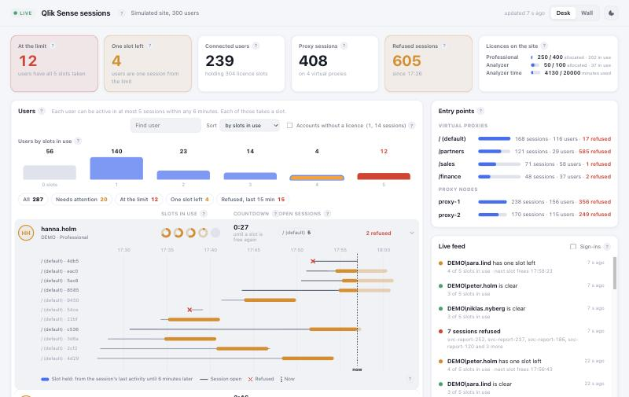
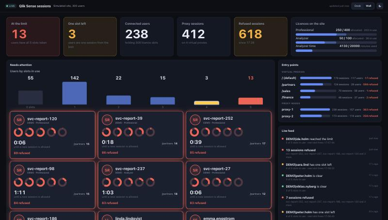

# Qlik Sense session monitor

A live web page for Qlik Sense Enterprise on Windows (client-managed). It shows who is connected right now, how close each user is to Qlik Sense's limit of **five sessions**, and who is being turned away with _"You cannot access Qlik Sense because you have too many sessions active in parallel."_



- **One page, updated every 15 seconds.** Countdowns and rings move every second in between.
- **Nothing to install on the Sense server.** It only reads Sense's own APIs, and changes nothing.
- **Help is built in.** Every **?** on the page explains the part next to it, with a diagram.

> **This is a live view, not a monitoring system.** It shows how things stand now and keeps no
> history. For real monitoring of Qlik Sense, with history over days, months and years, dashboards
> and alerting, use [Butler SOS](https://butler-sos.ptarmiganlabs.com). This live view is planned to
> become part of Butler SOS.

## Try it in two minutes, without a Sense server

You need [Node.js](https://nodejs.org) 24 or later. Check with `node --version`.

1. Get the code: download the Butler SOS repository from GitHub (_Code → Download ZIP_) and unzip
   it, or `git clone https://github.com/ptarmiganlabs/butler-sos.git`.
2. In a terminal (PowerShell on Windows), go to the `tools/session-monitor` folder inside it and
   start the demo:

    ```bash
    cd butler-sos/tools/session-monitor     # with the ZIP: butler-sos-master/tools/session-monitor
    npm ci
    npm run demo
    ```

3. Open **<http://127.0.0.1:3939/>** in your browser.

The demo makes up a site of 300 users. It follows the same rules as Qlik Sense: most users keep one session, some open several, a few hit the limit, and a couple of scripts keep starting new sessions. Stop it with **Ctrl+C**. For another size, use `node src/index.js --simulate 1000`.

## Connect it to your Qlik Sense site

This takes about ten minutes. You need to be a Sense administrator: the monitor uses the same certificates that Sense's own services use to talk to each other.

### 1. Pick a computer to run it on

Any Windows, macOS or Linux computer with Node.js 24 that can reach:

- the **central node** on port **4242** (the Repository), and
- **every proxy node** on port **4243** (the Proxy). On a single-server site that's the same server.

The central node itself works too, as long as Node.js is installed there.

### 2. Export certificates from the QMC

1. In the QMC, open **Certificates** and click **Export**.
2. **Machine name:** the name of the computer from step 1. Any name works; it only names the folder.
3. **Certificate password:** leave it **empty**.
4. **Include secret key:** tick it.
5. **Export file format for certificates:** choose **Platform independent PEM-format**.
6. Click **Export certificates**.

The files appear on the central node in
`C:\ProgramData\Qlik\Sense\Repository\Exported Certificates\<machine name>\`. Copy
`client.pem`, `client_key.pem` and `root.pem` to a folder on the computer from step 1, for example
`C:\sense-certs` or `/home/me/sense-certs`.

> **Treat these files like an administrator password.** Anyone who has them has full access to your
> Sense site through its APIs. Keep them in a folder only you can read, never email them, and never
> put them in a repository.

### 3. Create the configuration

In this folder, copy `config.example.yaml` to `config.yaml`:

```bash
cp config.example.yaml config.yaml          # macOS, Linux
Copy-Item config.example.yaml config.yaml   # Windows PowerShell
```

Open `config.yaml` and change the two lines marked **CHANGE THIS**:

```yaml
sense:
    host: sense.mycompany.com # your central node, by the name the QMC shows under Nodes
    certDir: 'C:\sense-certs' # the folder with the three .pem files
```

Use the server's name, not its IP address: the certificates are made for the name. On Windows,
keep the single quotes around the path.

### 4. Start it

```bash
npm ci       # only the first time
npm start
```

It prints `Open http://127.0.0.1:3939/ in your browser.` Do that. The first data arrives within a
few seconds. Stop it with **Ctrl+C**.

`node src/index.js --once` reads Sense once, prints a table of users and exits. It's a quick way to check the configuration without the page.

## Using the page

- **Overview tiles:** users at the limit, users with one slot left, connected users, proxy sessions,
  refused sessions, and the site's licences (as the QMC's licence summary shows them).
- **Users by slots in use:** how many users hold 0, 1, 2 … 5 slots. Click a bar to list those users.
- **Users:** five rings per user, one per slot. A ring empties over six minutes. The countdown
  shows when the next slot is free again, or, at the limit, when a new session will be allowed.
    - **Filter** with _Needs attention_, _At the limit_, _One slot left_ or _Refused_, search by name,
      and sort.
    - **Click a user** to see their sessions on a timeline.
- **Entry points:** sessions, users and refusals per virtual proxy and per proxy server.
- **Live feed:** refusals and alerts as they happen. Tick _Sign-ins_ to see every new session too.
- **Desk or Wall** (top right): _Wall_ is for a second screen or a TV. It shows only users who need
  attention, in large tiles, and a calm "All users are within limits" when no one does.
- **Light or dark** (top right), or set both in the address: `http://127.0.0.1:3939/?mode=wall&theme=dark`.



## The five-session limit in short

Qlik Sense lets each user be **active in at most five different sessions within any six minutes**.
The page calls each of those a **slot**.

- **A session takes a slot when it gets in:** its first page load in a new browser, an incognito
  window, or a script without a saved cookie.
- **The slot is taken until six minutes after the session was last active,** where "active" means
  opening an app. Then it is free again, even if the session stays open.
- **With all five slots taken, a new session is refused.** Sessions that are already in keep
  working.
- **Closing sessions doesn't help.** Signing out, closing the browser or ending sessions in the QMC
  frees no slot sooner. Only waiting does.
- **It counts across all virtual proxies and servers** together.

The **?** next to _Users_ on the page explains this with a diagram. These figures were measured on Qlik Sense May 2026. Qlik's help says five minutes, but six (360–370 seconds) is what was measured, by Qlik Support as well.

## If something doesn't work

The monitor says what's wrong when it starts. The common cases:

| Message                                                   | What to do                                                                                      |
| --------------------------------------------------------- | ----------------------------------------------------------------------------------------------- |
| `No configuration file found`                             | Copy `config.example.yaml` to `config.yaml` (step 3).                                           |
| `Certificate files not found`                             | Point `certDir` at the folder holding `client.pem`, `client_key.pem` and `root.pem` (step 2).   |
| `… can't be resolved from this computer`                  | Use the server's full DNS name in `host`.                                                       |
| `Can't reach … on ports 4242 and 4243`                    | Open those ports in the firewall between this computer and the Sense server(s).                 |
| `… must be the name the Sense certificates were made for` | Use the central node's name as the QMC shows it under **Nodes**, not an IP address or an alias. |
| `Use root.pem from the same QMC certificate export`       | All three files must come from the same export of the same site.                                |
| `Sense refused the client certificate`                    | Export the certificates again from this site's QMC.                                             |
| `Port 3939 is already in use`                             | Another copy is running: stop it, or set `outputs.web.port` to another port.                    |
| The page says **No data**                                 | The monitor has stopped or can't read Sense: look at its window for errors.                     |

## Showing the page to others

By default only the computer running the monitor can open the page (`127.0.0.1`). The page has
**no login of its own**. To show it to others, put it behind a reverse proxy that asks for sign-in
(IIS, nginx, Traefik …):

- **Proxy on the same computer:** keep `127.0.0.1`, and point the proxy at `http://127.0.0.1:3939`.
- **Proxy on another computer:** set `outputs.web.host` to this computer's address, and let the
  firewall allow port 3939 **only from the proxy**. Otherwise anyone on the network could skip the
  proxy's sign-in and open the page directly.

## Configuration reference

Everything except `sense.host` and `sense.certDir` has a sensible default. See the comments in
[config.example.yaml](config.example.yaml).

| Setting                                 | Default                         |                                                                        |
| --------------------------------------- | ------------------------------- | ---------------------------------------------------------------------- |
| `sense.host`                            | —                               | The central node. Proxy servers and virtual proxies are found from it. |
| `sense.certDir`                         | —                               | Folder with `client.pem`, `client_key.pem`, `root.pem`.                |
| `sense.virtualProxies`                  | all                             | Only watch these virtual proxy prefixes.                               |
| `outputs.web.host`, `outputs.web.port`  | `127.0.0.1`, `3939`             | Where the page listens.                                                |
| `outputs.web.title`                     | server name                     | The name in the page header.                                           |
| `outputs.web.timelineMinutes`           | 30                              | How far back a user's timeline reaches.                                |
| `outputs.console.table`                 | `false`                         | Also print a table of users at every update.                           |
| `poll.intervalSeconds`                  | 15                              | How often Sense is read.                                               |
| `limit.sessions`, `limit.windowSeconds` | 5, 360                          | The limit and its window.                                              |
| `limit.warnAt`, `limit.criticalAt`      | 4, 5                            | When a user shows as _one slot left_ and _at the limit_.               |
| `limit.excludeUsers`                    | Sense's internal `sa_` accounts | Users never shown, as `DIRECTORY\userid`.                              |

### Optional: pass alerts on to other systems

Neither is needed for the page.

- **Webhook** (`outputs.webhook`): each alert and refusal is POSTed as JSON. The bearer token comes from the environment variable named in `tokenEnv`. Example:

    ```json
    {
        "source": "qseow-session-monitor",
        "type": "alert",
        "at": "2026-11-14T14:23:36.720Z",
        "level": "critical",
        "change": "raised",
        "userDirectory": "CORP",
        "userId": "jane.doe",
        "slotsUsed": 5,
        "slotsLimit": 5,
        "proxySessions": 6,
        "nextSlotFreeAt": "2026-11-14T14:29:17.417Z"
    }
    ```

- **MQTT** (`outputs.mqtt`), for Node-RED, Home Assistant and the like. The user name and password come from the environment variables named in the configuration.

    | Topic below `topicRoot`     | Content                                     |
    | --------------------------- | ------------------------------------------- |
    | `alert`                     | Each alert (JSON).                          |
    | `refused`                   | Each refused session (JSON).                |
    | `summary`                   | Totals, every update (retained).            |
    | `user/<directory>/<userid>` | Each user's state, every update (retained). |

## How it works

Every 15 seconds the monitor reads Sense:

- **The open sessions** on every proxy server and virtual proxy (Proxy API, port 4243).
- **Sense's licence usage records** (Repository API, port 4242). Each record tells when a session last
  took a licence check. That is what the five-session limit counts: records younger than six minutes
  are the slots.
- **The licence allocations and totals,** about once a minute.

A **refused session** is a new session of a licensed user that never gets a licence record. Checked
against Sense's own licence log, every session found that way was a real refusal. It can miss a
refused session that is closed again within 15 seconds, which in practice means scripts. Accounts
without a licence (service accounts) are never counted as refused.

On a large site, only records from the last half hour are read, the page draws 50 users at a time,
and each user's timeline is only sent when it's opened. The page was checked with 1,000 simulated
users.

**Not covered yet:** sites with several proxy nodes are read, but this was tested on a single-node site. Analyzer capacity and token-based licences aren't read. Direct engine connections (port 4747) weren't checked.

## For developers

```bash
npm test                              # unit tests
node src/index.js --simulate 300      # the demo, with a config file of your own: add --config
```

The code: `src/collect.js` reads Sense, `src/model.js` turns readings into users, slots and events,
`src/simulate.js` is the demo site, `src/outputs/` holds the console, web page, webhook and MQTT
outputs, and `src/web/` is the page itself (plain HTML, CSS and JavaScript, no build step, nothing
loaded from the internet).

## Credits

- **Finding every proxy server and virtual proxy from the Repository** follows Ctrl-Q's `session-get` command ([ptarmiganlabs/ctrl-q](https://github.com/ptarmiganlabs/ctrl-q), MIT).
- **Joining proxy sessions to licence usage records** is an idea from Christof Schwarz's sessionTerminator ([ChristofSchwarz/qs-OEM-tricks](https://github.com/ChristofSchwarz/qs-OEM-tricks)). No code was taken from it.

## Licence

MIT, as Butler SOS.
